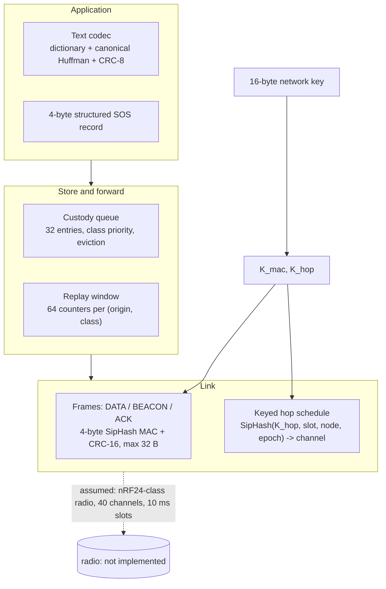

# LifeLine-Mesh

> **Archived 2026-11-23.** Why: this is a protocol design, a simulator and a host-compiled C reference
> that never met a radio, and no field or hardware test is planned. The weaknesses listed under
> [Known weaknesses](#known-weaknesses) are not fixed. The code stays readable and runnable; it is not
> maintained, the roadmap below is not scheduled, and it must not be relied on for real emergencies.

**Design, executable model and C99 reference for an offline emergency-messaging mesh: authenticated 32-byte frames, keyed channel hopping, custody-transfer store-and-forward, and a compact text codec.**

[](https://github.com/Kavin-Re/LifeLine-Mesh/actions/workflows/ci.yml)


> **Status.** This is a protocol design with a host-compiled C reference and a simulator.
> There is **no hardware, no RF measurement and no field trial** behind anything here. Radio and
> energy figures are stated assumptions. Do not rely on this for real emergencies.

When infrastructure is down, people still need to say "trapped, second floor, three people".
LifeLine-Mesh is a study of how far a network of cheap 2.4 GHz packet radios (nRF24-class,
32-byte payloads) can carry short messages like that: SOS traffic first, across node failures,
partitions and narrowband jamming.

## What is in the repository

| Layer | What exists | Where |
|---|---|---|
| Specification | Frame formats, hop schedule, replay window, custody rules, threat model | [`docs/PROTOCOL.md`](docs/PROTOCOL.md) |
| C99 reference core | SipHash-2-4, CRC, frame encode / decode, hop schedule, replay window, custody queue. About 400 lines, no dynamic allocation | [`c/`](c/) |
| Python executable model | The same protocol, byte for byte, plus the text codec | [`python/lifeline/`](python/lifeline/) |
| Network simulator | Flooding vs gossip vs custody under load, failures, jamming, mobility | [`python/lifeline/sim.py`](python/lifeline/sim.py), [`python/run_sweeps.py`](python/run_sweeps.py) |
| Results | Claims, evidence and caveats, with raw CSV / JSON | [`results/results.md`](results/results.md) |



## Design in one page

- **Frames.** DATA (18 to 32 bytes, up to 14 bytes of payload), BEACON and ACK (15 bytes each).
  Every frame carries a 4-byte truncated SipHash-2-4 MAC and a CRC-16. Messages are
  authenticated, not encrypted.
- **Keyed hopping.** A superframe is 64 slots of 10 ms: one beacon slot, four common slots,
  59 private slots. Each node listens in a few private slots per superframe, and both the slots
  and the channels come from SipHash under `K_hop` with rejection sampling. Any key holder can
  compute where a neighbour will be listening; a jammer without the key cannot.
- **Custody transfer.** A holder keeps its copy until the next hop answers ACCEPTED or
  DUPLICATE, then deletes it. No ACK means back off and retry, possibly through another neighbour.
- **Priorities.** Three classes (SOS, STATUS, BULK). Transmit order is class, then age. A full
  queue evicts the oldest entry of a strictly lower class; SOS is never evicted by lower classes.
- **Anti-replay.** A 64-counter sliding window per (origin, class), checked after the MAC.
- **Text codec.** A 426-word dictionary (English and Hindi in Roman script) with a static
  canonical Huffman code and a CRC-8.

## Results at a glance

All numbers come from the simulator and scripts in this repository. The "+-" figures are 95 %
t-intervals over 8 seeds: they describe seed-to-seed spread of the simulator, not real-world
uncertainty. Read [`results/results.md`](results/results.md) for the full tables and caveats.

**Baseline** (36 nodes, 1 km square, one gateway, 0.4 messages/s):

| Protocol | Delivery | Median latency | Data frames per delivered message | Mean current (model) |
|---|---:|---:|---:|---:|
| Flooding | 0.69 +- 0.07 | 2.0 s | 38 | 69 uA |
| TTL gossip | 0.78 +- 0.06 | 14.2 s | 138 | 72 uA |
| Custody | 1.00 +- 0.00 | 1.9 s | 4.0 | 145 uA |

**Jamming** (400 m disc at the centre, J of 40 channels blocked):

| J blocked | Custody, keyed hop | Custody, fixed channel |
|---:|---:|---:|
| 0 | 1.00 | 1.00 |
| 10 | 1.00 | 0.73 +- 0.07 |
| 30 | 0.96 +- 0.03 | 0.73 |

**Overload** (10 messages/s): with class priority, SOS delivery is 0.996 while BULK falls to 0.10.
With plain FIFO queues SOS delivery drops to 0.68. Priority protects SOS by sacrificing BULK; it
does not create capacity.

**Text codec** (32 held-out English messages): 2.71x smaller than the canonical ASCII text, mean
12.5 bytes, 72 % fit a single 14-byte frame and all fit in two.

**Implementation checks:** 288,113 cross-language checks pass (15,940 shared test vectors generated
by the Python model and replayed by the C code), the fuzz harness runs clean under ASan and UBSan,
and no object file references an allocator.

Two caveats matter enough to repeat here. Flooding and gossip are confined to the four common
slots while custody uses the 59 private slots, so part of custody's advantage is a consequence
of the link design rather than of custody itself. And the simulator uses unit-disk links with
perfect slot synchronisation.

## Quick start

### C reference

Needs `make` and gcc or clang.

```bash
cd c
make test        # strict C99 build (-Wall -Wextra -Wpedantic -Wshadow -Wconversion -Werror) + shared vectors
make nomalloc    # fails if any library object references malloc / calloc / realloc / free
make san         # unit tests and fuzz under AddressSanitizer + UBSan (ITERS=2000000 by default)
```

### Python model and simulator

```bash
python -m pip install -r requirements.txt     # numpy, pytest
python -m pytest -q python/tests              # 26 tests

cd python
python run_sweeps.py 8      # all simulation sweeps, 8 seeds (about 18 minutes on 2 cores)
python eval_codec.py        # codec evaluation   -> results/codec_eval.json
python sim_resync.py        # cold-start beacon acquisition Monte Carlo -> results/resync.json
python tools_gen_vectors.py ../c/tests        # regenerate the C test vectors from the model
```

The scripts overwrite the files in `results/`. Pass an output directory as the last argument to
write elsewhere.

### Using the C core

```c
#include "lifeline.h"

ll_keys_t keys;
ll_replay_t replay;
ll_keys_derive(&keys, master_key);            /* 16 uniformly random bytes */
ll_replay_init(&replay);

ll_data_t msg = { .cls = LL_C_SOS, .ttl = 8, .life = 15, .origin = 0x0012, .ctr = 41, .plen = 4 };
uint8_t frame[LL_MAX_FRAME]; size_t n;
ll_encode_data(&keys, &msg, frame, sizeof frame, &n);

ll_frame_t rx;
if (ll_decode(&keys, frame, n, &rx) == LL_OK &&
    ll_replay_check_and_update(&replay, rx.data.origin, rx.data.cls, rx.data.ctr) == LL_RP_NEW) {
    /* take custody: ll_q_push(...) and answer with an ACK */
}
```

## Verification

| Claim | How it is checked |
|---|---|
| C and Python agree on frames, keys, hop schedule, replay window and queue | `python/tools_gen_vectors.py` writes `c/tests/vec_*.txt`; `make test` replays them |
| SipHash-2-4 matches the reference vectors; CRC and MAC reject tampering | `python/tests/test_core.py`, `c/tests/test_main.c` |
| Decode never reads out of bounds; an accepted frame re-encodes to the same bytes | `c/fuzz/fuzz_main.c` under ASan + UBSan |
| No dynamic allocation | `make nomalloc` |
| Codec round trip and error detection | `python/tests/test_codec.py`, `python/eval_codec.py` |
| Simulator sanity | `python/tests/test_sim.py` |

CI builds and tests the C core with gcc and clang (sanitizer and fuzz run with gcc), runs the Python tests, and a check that the committed test
vectors are exactly what the model generates.

## Known weaknesses

These are design limits, stated in the specification (section 12) unless marked otherwise.

- **Shared network key.** One captured node leaks `K_mac` and `K_hop`. No per-node keys, no revocation.
- **4-byte MAC.** Forgery probability 2^-32 per attempt; that is what a 32-byte frame leaves room for.
- **Per-hop fields are not authenticated.** `ttl`, `life`, `prev` and `next` are covered by the CRC
  only, so an attacker can rewrite them on a captured frame, for instance to stop it propagating.
- **No confidentiality** and origin ids travel in the clear.
- **Replay-table eviction.** When the 64-entry table is full, an evicted origin's old frames can be
  accepted again. This causes duplicates, not forgery.
- **Beacon time.** A node that has lost its persisted `floor_epoch` can be set back by a replayed beacon.
- **Hopping does not help** against a jammer holding the key, a wideband jammer, or a follower that
  reacts inside a 10 ms slot. None of these was simulated.
- **Single custody copy.** A holder that dies takes its queued messages with it.

Found during review of this repository and not yet in the specification:

- **ACK frames are not bound to an addressee or to a transmission attempt.** The MAC covers
  `acker`, `origin`, `class` and `ctr`. A recorded ACCEPTED or DUPLICATE ACK could therefore be
  replayed to another node holding a duplicate of the same message and make it release custody.
- **A locked node only bounds each beacon against its current clock.** `ll_sync_accept` does not
  consult `floor_epoch` once locked, so if the caller re-bases its clock on every accepted beacon,
  replayed beacons could walk it backwards by `tolerance` superframes at a time. Rejecting beacons
  more than `tolerance` below `floor_epoch` would bound the total drift.

## Limitations

- No radio driver, no MCU port, no timing or size measurements on a target.
- Simulator: unit-disk connectivity, no fading or capture, perfect slot synchronisation once
  locked, one frame per message, 8 seeds, 20 to 36 nodes, one workload shape.
- Energy: assumed datasheet-typical nRF24L01+ currents, no MCU, crystal or regulator model. The
  battery-life arithmetic in the results is an upper bound.
- Codec: the 171-message corpus is synthetic and written by one author with the same vocabulary as
  the dictionary, so the compression ratio is optimistic for other styles of text. No Devanagari.
  The codec exists in Python only.
- The C core has been built and tested on little-endian x86-64 hosts only.

## Related projects

The keyed hop schedule continues the work in [FHSS-Link](https://github.com/Kavin-Re/FHSS-Link).
[HopBench](https://github.com/Kavin-Re/HopBench) grades hop schedules, including a SipHash-keyed
one, against prediction attacks.

## Roadmap

- Port the C core to a real radio (nRF24L01+ on an STM32 or ESP32) and measure timing and current.
- Close the two review findings above in the specification, model and C code.
- Per-node keys or a group-key update mechanism.
- C implementation of the text codec.

## License

Copyright 2026 Kavin K K. Licensed under the [Apache License, Version 2.0](LICENSE); see also [NOTICE](NOTICE).
